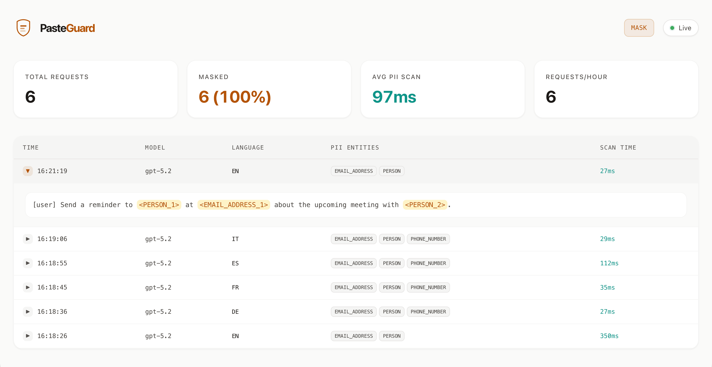

<p align="center">
  
</p>

<p align="center">
  <a href="https://github.com/sgasser/pasteguard/actions/workflows/ci.yml"></a>
  <a href="LICENSE"></a>
</p>

<p align="center">
  Privacy proxy for LLMs. Masks personal data and secrets before sending to your provider.
</p>

<p align="center">
  <a href="#quick-start"><strong>Quick Start</strong></a> ·
  <a href="https://pasteguard.com/docs"><strong>Documentation</strong></a> ·
  <a href="https://pasteguard.com/docs/integrations"><strong>Integrations</strong></a>
</p>

<br/>



## Features

- **Mask Mode** — Replace PII with tokens, unmask in response. Supports streaming.
- **Route Mode** — Sensitive requests → local LLM, everything else → cloud. Data never leaves your network.
- **Secrets Detection** — Block, redact, or route requests containing API keys, tokens, private keys
- **24 Languages** — Auto-detect language and mask PII accordingly
- **OpenAI-Compatible** — Drop-in replacement, works with any OpenAI client
- **Self-Hosted** — Run on your infrastructure, full control over your data
- **Dashboard** — Monitor requests, view masked content, track usage

## How It Works

```
You send:           "Email john@acme.com about the meeting with Sarah Miller"
LLM receives:       "Email <EMAIL_ADDRESS_1> about the meeting with <PERSON_1>"
LLM responds:       "I'll contact <EMAIL_ADDRESS_1> to schedule with <PERSON_1>..."
You receive:        "I'll contact john@acme.com to schedule with Sarah Miller..."
```

PasteGuard sits between your app and the LLM provider. It's OpenAI-compatible — just change the base URL.

## Quick Start

```bash
git clone https://github.com/sgasser/pasteguard.git
cd pasteguard
cp config.example.yaml config.yaml
docker compose up -d
```

Point your app to `http://localhost:3000/openai/v1` instead of `https://api.openai.com/v1`.

Dashboard: http://localhost:3000/dashboard

For multiple languages, configuration options, and more: **[Read the docs →](https://pasteguard.com/docs/quickstart)**

## Integrations

Works with any OpenAI-compatible tool:

- Cursor
- Open WebUI
- LibreChat
- OpenAI Python/JS
- LangChain
- LlamaIndex

**[See all integrations →](https://pasteguard.com/docs/integrations)**

## What It Detects

**PII**
- Names
- Emails
- Phone numbers
- Credit cards
- IBANs
- IP addresses
- Locations

**Secrets**
- OpenSSH private keys
- PEM private keys
- OpenAI API keys
- AWS API keys
- GitHub API keys
- JWT tokens
- Bearer tokens

Powered by [Microsoft Presidio](https://microsoft.github.io/presidio/).

## Tech Stack

[Bun](https://bun.sh) · [Hono](https://hono.dev) · [Microsoft Presidio](https://microsoft.github.io/presidio/) · SQLite

## License

[Apache 2.0](LICENSE)
